# 🛡️ Awesome Advanced Risk Management 🚀

### ✨ Curated Directory of Enterprise GRC, Financial & Quantitative Risk Engines, Cyber Threat Platforms & Open-Source Security Frameworks ✨

  <b>A comprehensive knowledge base covering Enterprise Risk Management (ERM), Governance, Risk &amp; Compliance (GRC), Quantitative &amp; Financial Market Risk, Operational Resilience, and Open-Source Cyber Threat Intelligence.</b>
   
  <i>Auditing transparent SaaS enterprise pricing, free tier &amp; trial limitations, corporate valuation scale, and star-ranked open-source codebases.</i>

---

## 📑 Table of Contents

- [📊 Sector Overview & Market Dynamics](#-sector-overview--market-dynamics)
- [🏢 SaaS & Commercial Platforms](#-saas--commercial-platforms)
- [💻 Open-Source GitHub Projects](#-open-source-github-projects)
- [🤝 Support](#-support)
- [📈 Star History](#-star-history)
- [🛠️ How to Contribute](#️-how-to-contribute)
- [⚖️ Disclaimer](#️-disclaimer)

---

## 📊 Sector Overview & Market Dynamics

The global **Enterprise Governance, Risk, and Compliance (GRC) and Financial Risk Management market** is estimated at **$54.6B in 2024 and projected to surpass $134B by 2032** at an estimated CAGR of **11.8%**, propelled by surging regulatory mandates (DORA, NIS2, SEC cyber disclosures, EU AI Act), rapid multi-cloud migration, and sophisticated systemic cyber and supply-chain threats.

The sector exhibits **moderate fragmentation with specialized sub-segment concentration** rather than a winner-take-all monopoly:
- **Core Enterprise GRC & Ecosystem Workflows:** Large multi-product incumbents like [ServiceNow](https://www.servicenow.com/) and [Workiva](https://www.workiva.com/) dominate broad enterprise operational workflows, financial reporting, and IT transformation suites.
- **Dedicated GRC & Resilience Suites:** Pure-play market leaders ([MetricStream](https://www.metricstream.com/), [AuditBoard](https://www.auditboard.com/), [Archer](https://www.archerirm.com/), [Diligent](https://www.diligent.com/), [Riskonnect](https://riskonnect.com/)) command dedicated segments spanning internal audit, board governance, integrated risk management (IRM), and insurance claims operations.
- **Privacy & Third-Party Cyber Risk:** Category disruptors like [OneTrust](https://www.onetrust.com/) and [LogicGate](https://www.logicgate.com/) lead data privacy compliance, automated TPRM (third-party risk management), and agile no-code cyber workflows.
- **Open-Source Infrastructure & Quant Engines:** Community-driven repositories ([Wazuh](https://github.com/wazuh/wazuh), [OpenCTI](https://github.com/OpenCTI-Platform/opencti), [Guardrails AI](https://github.com/guardrails-ai/guardrails), [Open Source Risk Engine](https://github.com/OpenSourceRisk/Engine)) provide mission-critical building blocks for sovereign SIEM, automated vulnerability scoring, financial risk modeling, and LLM safety.

---

## 🏢 SaaS & Commercial Platforms

*Enterprise GRC, integrated risk management (IRM), operational risk, audit, and vendor risk platforms sorted by company valuation/revenue in descending order.*

| Product 🛡️ | Description 📝 | Company Valuation / Revenue 🏢 | Pricing 💳 | Free Tier / Free Trial Limits ⏱️ |
| :--- | :--- | :--- | :--- | :--- |
| **[ServiceNow IRM](https://www.servicenow.com/products/integrated-risk-management.html)** | Enterprise integrated risk and compliance suite unifying operational risk, vendor risk, business continuity, and audit on the Now Platform. | **~$190B Market Cap** (ServiceNow, Inc., NYSE: NOW; ~$10.9B+ annual revenue) | Enterprise packages start from **$100,000/year** (Standard enterprise deployments typically $100K–$250K+ ACV based on role-based licenses & modules) | **No public self-service free trial** (Custom guided sandbox demo tenant provisioned exclusively for enterprise evaluations upon sales engagement). |
| **[Workiva](https://www.workiva.com/)** | Cloud reporting, audit, and GRC platform linking financial disclosures, operational risk, internal controls, and ESG data. | **~$4.5B Market Cap** (Workiva Inc., NYSE: WK; ~$630M+ annual revenue) | Annual subscriptions start from **$30,000/year** (Typical corporate audit and SOX compliance tiers range from $30K to $75K/yr) | **No self-service free trial** (Guided hands-on proof-of-concept workspace provided following enterprise discovery consultation). |
| **[Diligent](https://www.diligent.com/)** | Modern governance, risk, audit, and ESG SaaS suite serving corporate boards and compliance executives across 130+ countries. | **~$7B Valuation** (Privately held, backed by Clearlake Capital; ~$600M+ annual revenue) | Module packages start from **$20,000/year** (Diligent One platform deployments typically scale between $20K and $120K/yr depending on modules) | **No self-service free trial** (Proof of concept sandbox access provided for enterprise risk & governance teams upon request). |
| **[OneTrust](https://www.onetrust.com/)** | Market-leading trust intelligence platform automating privacy management, third-party risk management (TPRM), data governance, and GRC. | **~$4.5B Valuation** (Privately held; backed by SoftBank Vision Fund 2 & Insight Partners; ~$400M+ ARR) | Privacy and vendor risk modules start from **$50,000/year** (Enterprise compliance bundles commonly exceed six figures, $100K–$150K/yr) | **14-day free trial** (Available on select self-service modules like Cookie Consent / Assessment Automation; limited to 1 user and single domain evaluation). |
| **[AuditBoard](https://www.auditboard.com/)** | Collaborative cloud platform purpose-built for SOX compliance, internal audit management, vendor risk, and enterprise risk management. | **$3B Acquisition Valuation** (Acquired by HGGC in 2024; ~$200M+ ARR) | Base contracts start from **$45,000/year** (Verified Vendr median starting contract ~$45K/yr; enterprise deployments scale to $100K+/yr) | **No self-service free trial** (Personalized product demonstrations and pilot environments provided upon vendor evaluation request). |
| **[MetricStream](https://www.metricstream.com/)** | AI-powered enterprise GRC and cyber risk quantification suite with ConnectedGRC architectures for global organizations. | **~$1B Valuation** (Privately held, recognized Tier-1 GRC leader; ~$150M+ annual revenue) | Platform contracts start from **$75,000/year** (Mid-tier to enterprise deployments typically range from $75K to $200K+ annually) | **No public free trial** (Custom interactive guided walkthrough and scoped enterprise pilot sandbox upon sales qualification). |
| **[Archer](https://www.archerirm.com/)** | Pioneer integrated risk management (IRM) platform covering enterprise risk, cyber risk, third-party governance, and compliance. | **~$1.2B Valuation** (Acquired by Cinven; established Tier-1 GRC suite; ~$140M+ annual revenue) | Enterprise licensing starts from **$60,000/year** (Core deployment packages typically scale from $60K to $250K+ ACV) | **No self-service free trial** (Dedicated test environment provisioned during formal procurement evaluations). |
| **[Riskonnect](https://riskonnect.com/)** | Integrated risk management (IRM) software consolidating enterprise risk, insurable risk, healthcare risk, and internal audit. | **~$800M Valuation** (Privately held, backed by TA Associates; ~$100M+ annual revenue) | Entry modules start from **$30,000/year** (Comprehensive risk and claims management suites scale between $30K and $90K/yr) | **No self-service free trial** (Demonstration sandbox and scenario testing access provided for enterprise risk managers). |
| **[LogicGate](https://www.logicgate.com/)** | No-code Risk Cloud platform enabling dynamic risk management, automated workflows, controls testing, and cyber risk quantification. | **~$300M Valuation** (Privately held; raised ~$156M in venture funding; ~$30M+ ARR) | Risk Cloud subscriptions start from **$25,000/year** (Scales dynamically based on active applications and workflows, typically $25K–$200K/yr) | **14-day free trial** (Risk Cloud interactive sandbox trial provided upon enterprise sign-up with pre-built application templates). |

---

## 💻 Open-Source GitHub Projects

*Curated open-source security platforms, vulnerability management engines, threat intelligence networks, financial risk calculators, and AI guardrails sorted by GitHub Stars_Counts in descending order.*

| Project 🌟 | GitHub_Stars ⭐ | Description 📖 |
| :--- | :--- | :--- |
| **[Wazuh](https://github.com/wazuh/wazuh)** |  | Open-source enterprise security platform providing unified XDR and SIEM protection across endpoints, cloud workloads, compliance auditing, and active response. |
| **[OpenCTI](https://github.com/OpenCTI-Platform/opencti)** |  | Unified open cyber threat intelligence (CTI) management platform designed to structure, store, organize, and visualize operational, tactical, and strategic cyber threats. |
| **[Guardrails AI](https://github.com/guardrails-ai/guardrails)** |  | Open-source AI risk engine and reliability framework adding verifiable safety guardrails, PII masking, toxic prompt detection, and structured validation to LLMs. |
| **[CALDERA](https://github.com/mitre/caldera)** |  | MITRE-built scalable automated adversary emulation system that executes intelligent agent-based cyber attack simulations to test enterprise defense posture. |
| **[Faraday](https://github.com/infobyte/faraday)** |  | Open-source collaborative vulnerability management and offensive security platform that aggregates scan outputs, orchestrates pentests, and tracks remediation. |
| **[Pyfolio](https://github.com/quantopian/pyfolio)** |  | Quantitative financial risk analytics and portfolio performance framework in Python, generating tear sheets for Sharpe ratio, Value at Risk (VaR), and drawdowns. |
| **[FinanceToolkit](https://github.com/JerBouma/FinanceToolkit)** |  | Transparent and comprehensive financial analysis toolkit calculating 150+ quantitative ratios, risk metrics (Beta, Value-at-Risk, Expected Shortfall), and cash flows. |
| **[DefectDojo](https://github.com/DefectDojo/django-DefectDojo)** |  | Premier open-source DevSecOps, AppSec, and Application Security Posture Management (ASPM) tool orchestrating vulnerability tracking and pipeline risk remediation. |
| **[ArcherySec](https://github.com/archerysec/archerysec)** |  | Application Security Orchestration and Correlation (ASOC) and DevSecOps platform to automate security scans, deduplicate findings, and track software risk. |
| **[OpenSCAP](https://github.com/openscap/openscap)** |  | NIST-certified Security Content Automation Protocol (SCAP 1.2) ecosystem providing automated system security hardening, vulnerability assessment, and compliance policy checks. |
| **[CVE Binary Tool](https://github.com/intel/cve-bin-tool)** |  | Intel-developed binary scanner and software supply-chain risk analyzer that audits SBOMs and identifies known CVE vulnerabilities in system components. |
| **[Open Source Risk Engine (ORE)](https://github.com/OpenSourceRisk/Engine)** |  | Financial risk calculation engine implementing contemporary derivative pricing, stress testing, Value at Risk (VaR), and regulatory capital calculations (Basel/FRTB). |
| **[SimpleRisk](https://github.com/SimpleRisk/simplerisk)** |  | Simple, intuitive, open-source enterprise risk management application for identifying, assessing, mitigating, and monitoring governance and compliance risks. |

---

## 🤝 Support

Thank you for exploring and utilizing **Awesome-Advanced-Risk-Management**! 💖

If you found this directory valuable for your enterprise risk architecture, security research, or quantitative models, please consider:
- 🌟 **Starring** this repository on GitHub to increase visibility for the community
- 🍴 **Forking** and contributing missing tools, updated pricing models, or benchmarks
- 📢 **Sharing** with fellow risk managers, compliance officers, security engineers, and quants
- ☕ **Buying a coffee / Sponsoring** the maintainer via the [GitHub Sponsor Dashboard](https://github.com/sponsors/ishandutta2007)

Your support powers continuous curation, vendor research, and maintenance across open-source risk frameworks!

---

## 📈 Star History

---

## 🛠️ How to Contribute

Contributions are warmly welcomed! To suggest a new tool, framework, or update:

1. **Fork** the repository.
2. **Create a branch** for your addition (`git checkout -b feature/add-new-risk-platform`).
3. Add the SaaS product or Open-Source project ensuring:
   - For SaaS tools: Exact starting price and explicit free tier/trial limits.
   - For Open-Source repositories: Official GitHub link, Stars_Badge (`style=social&color=white`), and concise description.
4. **Commit** your changes (`git commit -m "feat: add [Tool Name]"`).
5. **Push** to your branch and submit a **Pull Request**.

---

## ⚖️ Disclaimer

*All product names, logos, brands, and registered trademarks cited in this repository are the property of their respective owners. Pricing figures, valuation estimates, and tier limitations represent verified public vendor data, marketplace reports (e.g., Vendr), and SEC filings as of 2026, and may vary depending on enterprise custom agreements, user seats, and contractual terms.*
